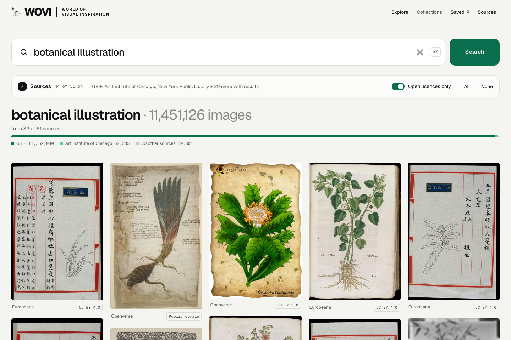
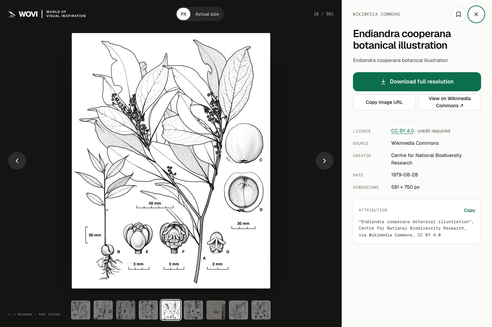

# 🔭 WOVI — World of Visual Inspiration

**Search 75 open image libraries from around the world at once — museums, archives, libraries and science collections — in one calm, image-first wall. Open any image in a detail view and download the highest resolution the source offers.**

WOVI runs on your own computer: a small Node.js server talks to the library APIs, and your browser shows the results. No account, no build step, no dependencies.



> [!IMPORTANT]
> WOVI is a personal research tool, provided **as is**. It is not affiliated with any of the libraries it searches. You are responsible for following each source's terms of use and each image's licence. See [Disclaimer](#disclaimer).

---

## Contents

- [Features](#features)
- [Quick start](#quick-start)
- [The `.env` file](#the-env-file)
- [Sources](#sources)
- [Good to know](#good-to-know)
- [Development](#development)
- [Disclaimer](#disclaimer)
- [Licence](#licence)
- [Feedback and support](#feedback-and-support)

## Features

- **One search, 75 sources.** Results arrive as each source answers and are added to a masonry wall that never reshuffles.
- **Sources you control.** Turn sources on or off per search, or permanently in the Sources window. See hits per source at a glance.
- **Open licences only.** One switch hides everything that is not public domain or openly licensed.
- **Detail view.** Dark stage, Fit / Actual size (drag to pan), filmstrip, keyboard ← → / F / Esc, licence meaning ("credit & share alike") and a ready-to-copy attribution line.
- **Full-resolution downloads.** Single images or a selection; TIFF masters where a source offers them.
- **Saves stay in your browser.** Bookmark images and find them on the Saved page. Saves live only in `localStorage` — they are never sent anywhere. Export them as JSON.
- **Accessible.** Real buttons and links, visible focus, ⌘K / Ctrl K to search, reduced-motion support, works down to phone width.



## Quick start

**You need:** [Node.js](https://nodejs.org/) **26 or newer**. That's all — there is nothing to `npm install`.

```bash
git clone https://github.com/herrhelms/wovi-open-library.git
cd wovi-open-library
cp .env.example .env      # optional: add API keys (see below)
npm start
```

Open **<http://127.0.0.1:5173/>** and search.

- 66 of the 75 sources work **without any key**. Add keys later to unlock the rest.
- The server only listens on `127.0.0.1` (your own machine).
- Stop it with <kbd>Ctrl</kbd>+<kbd>C</kbd>. Use another port with `PORT=8080 npm start`.

## The `.env` file

API keys go into a file named `.env` in the project folder. The repository ships a template:

```bash
cp .env.example .env
```

Then open `.env` in a text editor, paste the keys you have, save, and **restart the server** (`Ctrl+C`, then `npm start`).

- Every key is optional. A source without its key shows a **KEY** tag and is skipped; everything else keeps working.
- Keys stay on your machine. The server uses them; the browser never sees them.
- `.env` is listed in `.gitignore`, so it is never committed. Don't paste keys anywhere else.
- Format: one `NAME=value` per line, no spaces around `=`. Lines starting with `#` are comments. Quotes are optional.
- Check the result in the app: **Sources** (top right) → each source shows *No key needed*, *Key set*, *Key optional* or *Key missing*. **Set up key** shows the steps for that source.

### Keys

| Variable | Sources | Needed? | Where to get it |
|---|---|---|---|
| `FLICKR_KEY` | Flickr Commons, Flickr (open licences) | Yes | [flickr.com/services/apps/create](https://www.flickr.com/services/apps/create/) — create an app, use the **Key** |
| `DPLA_KEY` | DPLA | Yes | Run `curl -X POST https://api.dp.la/v2/api_key/you@example.com` — the key arrives by e-mail |
| `NYPL_TOKEN` | New York Public Library | Yes | [api.repo.nypl.org](https://api.repo.nypl.org/) — sign up, copy the **token** |
| `HARVARD_KEY` | Harvard Art Museums | Yes | [harvardartmuseums.org/collections/api](https://harvardartmuseums.org/collections/api) |
| `TROVE_KEY` | Trove (National Library of Australia) | Yes | [trove.nla.gov.au](https://trove.nla.gov.au) → sign in → Profile → API |
| `PIXABAY_KEY` | Pixabay | Yes | [pixabay.com/api/docs](https://pixabay.com/api/docs/) — shown when you are logged in |
| `PEXELS_KEY` | Pexels | Yes | [pexels.com/api](https://www.pexels.com/api/) |
| `UNSPLASH_KEY` | Unsplash | Yes | [unsplash.com/developers](https://unsplash.com/developers) — create an app, use the **Access Key** |
| `EUROPEANA_KEY` | Europeana | Optional | Uses the shared demo key `api2demo` when empty. Personal key: [pro.europeana.eu/page/get-api](https://pro.europeana.eu/page/get-api) |
| `SMITHSONIAN_KEY` | Smithsonian Open Access | Optional, recommended | Uses `DEMO_KEY` when empty — only ~30 requests per hour. Personal key: [api.data.gov/signup](https://api.data.gov/signup/) |
| `DIGITALNZ_KEY` | DigitalNZ | Optional | Works without a key today. [digitalnz.org/developers](https://digitalnz.org/developers) |
| `PORT` | — | Optional | Port of the local server. Default `5173` |

> [!NOTE]
> Flickr, DPLA, Trove, Pixabay, Pexels, Unsplash and Harvard were built from their public API documentation and are marked *untested* in the app until someone runs them with a real key. Reports are welcome.

### A filled-in example

```dotenv
PORT=5173
FLICKR_KEY=0123456789abcdef0123456789abcdef
SMITHSONIAN_KEY=your-api-data-gov-key
EUROPEANA_KEY=
```

Empty values count as "not set".

## Sources

✓ = no key needed · 🔑 = key needed · (½) = optional key

**Open-licence aggregators** — Wikimedia Commons ✓ · Openverse ✓ · Flickr Commons 🔑 · Flickr (open licences) 🔑 · Internet Archive ✓ · Europeana (½) · DPLA 🔑 · Japan Search ✓ · Swedish heritage (K-samsök) ✓ · DigitalNZ (½) · PikiWiki Israel ✓ · Korean public institutions (KOGL Type 1) ✓ · Pixabay 🔑 · Pexels 🔑 · Unsplash 🔑

**Museums and galleries** — The Met ✓ · Smithsonian Open Access (½) · Rijksmuseum ✓ · National Gallery of Art ✓ · Art Institute of Chicago ✓ · Cleveland Museum of Art ✓ · Getty Museum ✓ · Minneapolis Institute of Art ✓ · SMK – National Gallery of Denmark ✓ · Paris Musées ✓ · Walters Art Museum ✓ · Brooklyn Museum ✓ · Auckland Museum ✓ · Princeton University Art Museum ✓ · Harvard Art Museums 🔑 · Web umenia (Slovak and Czech galleries) ✓ · Museu Paulista (USP) ✓ · National Palace Museum (Taiwan) ✓ · Australian War Memorial ✓ · Nationalmuseum Stockholm ✓ · Helsinki City Museum ✓ · Canadian Museum of History ✓ · McCord Stewart Museum ✓

**Libraries and archives** — Library of Congress (Free to Use) ✓ · New York Public Library 🔑 · British Library ✓ · Gallica (BnF) ✓ · Trove 🔑 · US National Archives ✓ · Nationaal Archief ✓ · German Federal Archive ✓ · ETH Library Zurich ✓ · State Library of Queensland ✓ · National Library of Norway ✓ · Digital Commonwealth ✓ · David Rumsey Map Collection ✓ · Royal Danish Library ✓ · Fortepan (Hungary) ✓ · Banco de la República (Colombia) ✓ · National Library of Israel ✓ · Arquivo Nacional (Brazil) ✓ · Instituto Moreira Salles ✓ · Archivo General de la Nación (Argentina) ✓ · State Library of NSW ✓ · Archives New Zealand ✓ · Finnish Heritage Agency ✓ · BAnQ (Québec) ✓ · Library and Archives Canada ✓ · City of Toronto Archives ✓ · Narodowe Archiwum Cyfrowe (Poland) ✓

**Science, nature and medicine** — NASA Image Library ✓ · ESA/Hubble ✓ · ESA/Webb ✓ · ESO ✓ · Wellcome Collection ✓ · Biodiversity Heritage Library ✓ · NOAA Photo Library ✓ · iNaturalist ✓ · GBIF ✓ · Natural History Museum, London ✓

33 of these are searched **through Wikimedia Commons**, because their own APIs are blocked, need a token, or don't exist: Paris Musées, Walters, Brooklyn, Auckland, British Library, Gallica, US National Archives, Nationaal Archief, German Federal Archive, ETH Library, State Library of Queensland, BHL, NOAA, and 20 collections from Israel, Latin America, Asia, Australia, New Zealand, the Nordics, Canada and Poland (PikiWiki Israel, KOGL, Museu Paulista, National Palace Museum, Australian War Memorial, Nationalmuseum Stockholm, Helsinki City Museum, Canadian Museum of History, McCord Stewart, National Library of Israel, Arquivo Nacional, Instituto Moreira Salles, Archivo General de la Nación, State Library of NSW, Archives New Zealand, Finnish Heritage Agency, BAnQ, Library and Archives Canada, City of Toronto Archives, Narodowe Archiwum Cyfrowe). Their names end in "(via Wikimedia Commons)" in the app.

## Good to know

<details>
<summary><b>The first search is slower for some sources</b></summary>

- **National Gallery of Art** has no search API. The first NGA search downloads its open-data CSV files (~175 MB) into `data/nga/` and builds an index. This takes a few minutes; the files are refreshed after 30 days.
- **Library of Congress** is searched through its 101 "Free to Use" sets (about 3,400 items). The first search reads them (about one minute) and keeps them for 7 days. The app shows "being prepared" and retries on its own.
- **Getty Museum** searches title words through SPARQL; one search takes about 8 seconds.
</details>

<details>
<summary><b>Rate limits</b></summary>

- **Wikimedia Commons** (34 sources) limits how fast one client may ask. WOVI sends one Commons request at a time, waits as Commons asks (`Retry-After`) and retries; the browser keeps at most two Commons searches open and starts the other sources first. Commons results arrive one after another over up to ~30 seconds.
- **Smithsonian** with `DEMO_KEY`: ~30 requests per hour — add a personal key.
- **Openverse** without a key: ~20 requests per minute, 200 per day, results stop near 240.
- **iNaturalist**: max 60 requests per minute.
- The server identifies itself to every source as `OpenLibraryFetch/0.1 (local research tool)`. It never pretends to be a browser and does not get around bot challenges.
</details>

<details>
<summary><b>Resolution and licence notes per source</b></summary>

- **David Rumsey Map Collection** is CC BY-NC-SA 3.0 — **non-commercial**. It is the only non-commercial source; the viewer shows a note.
- **The Met** can return objects that are not public domain; WOVI removes them, so a page can have fewer than 24 items.
- **Art Institute of Chicago** images load directly in your browser; "Download full resolution" opens the image (max 3000 px) in a new tab, and "Download selected" skips AIC items.
- **Cleveland Museum of Art** offers the print JPEG (~3,400 px) and, separately, the TIFF master (can be over 200 MB).
- **ESA/Hubble, ESA/Webb, ESO** give the largest JPEG of the item page; TIFF originals are not offered.
- **Library of Congress**: only Carol M. Highsmith items come at master size; other Prints & Photographs items at ~1,024 px, everything else at web size.
- **Pixabay**: max 1,280 px. **Unsplash**: downloads are reported to Unsplash, as its API terms require.
- **DPLA, Trove, DigitalNZ**: some records only have a thumbnail; the viewer links to the partner page.
- **Harvard, Trove**: no usable licence data — they are skipped when *Open licences only* is on.
- **Natural History Museum**: item pages can answer HTTP 403 to scripts; they work in a browser.
- **Local search terms work best** for Web umenia (Slovak/Czech, e.g. *mesiac*, *portrét*), Banco de la República (Spanish, e.g. *retrato*, *luna*), the Royal Danish Library (Danish, e.g. *portræt*), and many of the Commons collections from Brazil, Argentina, Finland and Poland.
- **Japan Search** shows public domain, CC0, CC BY and CC BY-SA items, including ColBase (Japan's national museums) and the National Diet Library.
- **Royal Danish Library**: only items marked free of copyright or CC BY. **Web umenia**: only free works. **Banco de la República**: only public domain items from five historic collections; multi-page objects are skipped.
- **Fortepan** is CC BY-SA 3.0 and asks for the credit "FORTEPAN / donor name" — the attribution box includes it. WOVI uses the search of the Fortepan website, which is not a documented public API and may change.
</details>

<details>
<summary><b>What “Open licences only” means</b></summary>

An item counts as open when its licence is public domain, CC0, the Public Domain Mark, a Creative Commons licence (including NC and ND), rightsstatements.org *No Copyright* / *No Known Copyright*, or the Pixabay / Pexels / Unsplash licence. "In copyright", "not evaluated", "undetermined" or unknown licences are hidden. The rule lives in `lib/license.js`.

Open does not always mean "free for any use": always check the licence shown in the detail view.
</details>

<details>
<summary><b>The <code>data/</code> folder</b></summary>

WOVI keeps local state in `data/` (ignored by git): which sources are on (`settings.sqlite`), a thumbnail cache (max 500 MB), the NGA index and the Library of Congress sets. You can delete the folder at any time; it is rebuilt when needed.
</details>

<details>
<summary><b>Root certificates</b></summary>

`certs/` holds two public root certificates (SSL.com TLS RSA Root CA 2022, HARICA TLS RSA Root CA 2021) that Node.js does not ship, and the public GeoTrust EV RSA CA G2 intermediate (issued by DigiCert Global Root G2). They are added to Node's list at start so that `data.getty.edu`, `kulturarvsdata.se`, `data.artmuseum.princeton.edu` and `babel.banrepcultural.org` (which sends no certificate chain) pass the TLS check. Certificate checks stay on.
</details>

## Development

```bash
npm test         # unit tests — offline, with fixtures
npm run smoke    # live check — one request to each source
```

**Add a source:** every source is one folder in `adapters/` with an `adapter.json` (name, group, key info, notes) and either an `index.js` or a shared base such as `commons-subset`. The server finds new folders at start. Step-by-step guide: [`docs/ADAPTERS.md`](docs/ADAPTERS.md).

```
server.js              HTTP server: static files and /api routes
adapters/<id>/         one folder per source (adapter.json, index.js, tests)
adapters/groups.json   source groups and their order
lib/                   shared code: loader, HTTP, Commons limiter, caches, licences
lib/bases/             shared factories for config-only sources
public/                the frontend: plain HTML, CSS and ES modules, no build
test/                  unit tests and fixtures
```

The design tokens (colours, type, spacing) live in `public/tokens.css`.

## Disclaimer

WOVI is an independent, non-commercial hobby project. It is **not affiliated with, endorsed by, or sponsored by** any of the libraries, museums, archives or services it searches. All names and trademarks belong to their owners.

WOVI only queries public APIs and pages on your behalf, from your own computer, with your own keys. **You are responsible for how you use it**, in particular for:

- following each source's **terms of use and API terms** (some forbid bulk downloading, caching, commercial use, or sharing keys),
- respecting the **licence and rights of every image** you download or reuse, including attribution and non-commercial conditions,
- complying with the laws that apply to you.

Licence information in WOVI comes from the sources and may be missing, outdated or wrong. Always check the item on the source's own page before you reuse it.

The software is provided **"as is", without warranty of any kind**. The author and contributors are **not liable** for any claim, damage, or other liability arising from the use of this software, or from anyone's use of the content it finds. See the [LICENSE](LICENSE).

## Licence

The WOVI source code is released under the [MIT License](LICENSE). This licence covers the code only — **not** the images, metadata or other content from the sources, which keep their own licences and terms.

The screenshots above show search results and *Endiandra cooperana botanical illustration* by the Centre for National Biodiversity Research, via Wikimedia Commons, CC BY 4.0.

## Feedback and support

Questions, ideas, a source that should be added, or a key-based source you could test? [Open an issue on GitHub](https://github.com/herrhelms/wovi-open-library/issues).

If you want to support its continuous development, consider [becoming a GitHub Sponsor](https://github.com/sponsors/herrhelms) ♥
